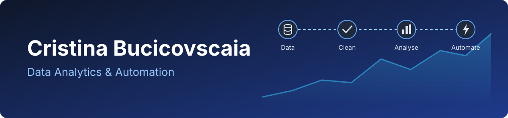

## Hi, I'm Cristina 👋

I am focused in **data analytics and automation**: taking raw business data, making it clean and trustworthy, turning it into clear insights and reports, and automating how those results reach the people who need them.

## What I do

- **Data preparation:** importing messy files, finding duplicates, missing values and inconsistent formats, and cleaning them without losing the original
- **Analysis and reporting:** business metrics, period comparisons, charts, dashboards and reports in formats people actually use
- **Automation:** connecting data to workflows with webhooks and tools such as Make.com, so reports and summaries are delivered without manual steps

## Tools I work with

| Area | Tools |
| --- | --- |
| Data analysis | Python, pandas, NumPy, SQLite |
| Visualisation | Recharts, dashboards, HTML and PDF reports |
| Automation | Make.com, webhooks, REST APIs |
| Web apps | FastAPI, React, TypeScript, Tailwind CSS |
| Quality and delivery | pytest, Docker, GitHub Actions, Render |
| AI-assisted development | Claude |

 

